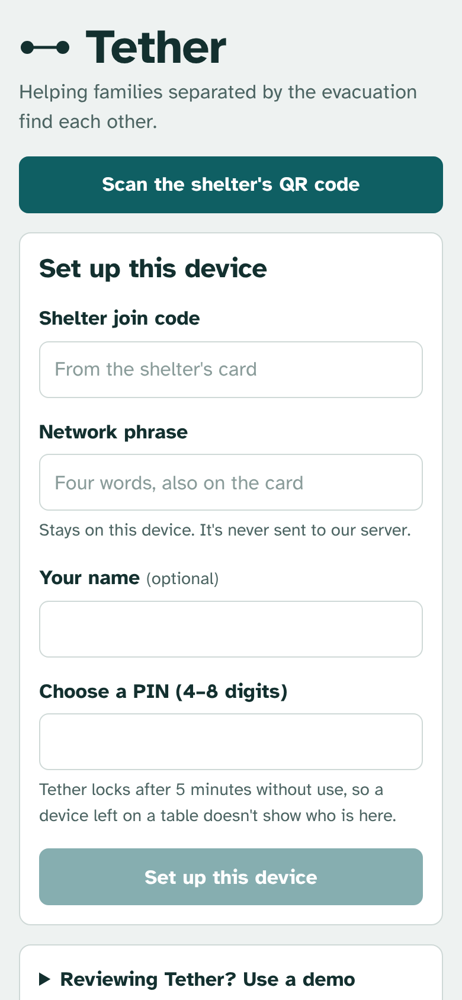
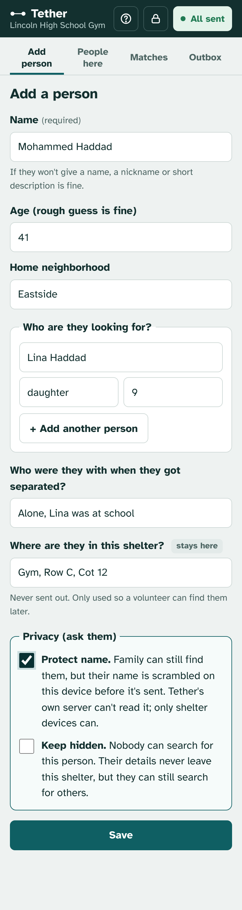
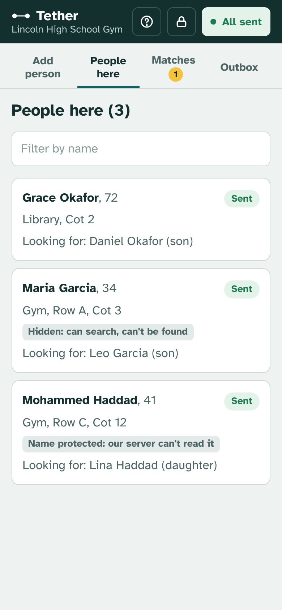
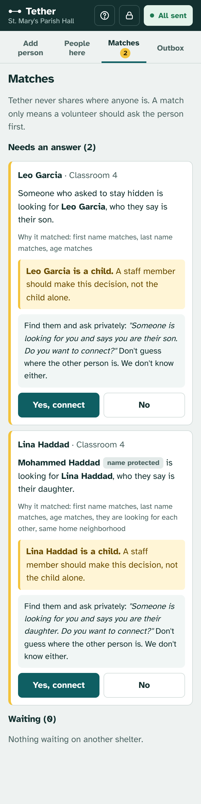
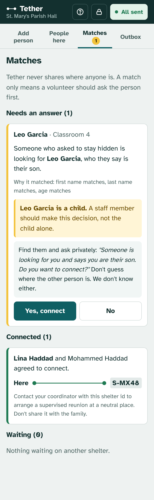

# Tether

**The word tether refers to the line that keeps two things connected across a distance. This is what our app does helping families scattered around to different shelters reconnect after a natural disaster like hurricanes.**

**Live app:** https://dashing-yeot-662880.netlify.app
**Try it in two minutes:** see [Try a match yourself](#try-a-match-yourself).

---

## Overview / Assumptions

The most important part of developing this project was the set of assumptions I made about the situation. Every design decision follows from one of these. 

1. **Tether was set up before hurricane season.** Emergency management registered every official shelter ahead of time and gave each one a printed card with a join code and QR code. *This is why only real shelters can join and why nobody can invent a shelter to fish for information.*

2. **Every shelter has at least one device that gets a connection now and then.** It could be a laptop or a staff member's phone, with Wi-Fi that comes and goes. Most *individuals* have no working phone but shelters aren't cut off for days. *This is why everything saves on the device locally first and sends whenever a connection appears.*

3. **Volunteers use the app, not evacuees.** Evacuees have no phones and are in crisis, so a volunteer does the typing for them. Volunteers are stretched thin and not technical. *This is why only a name is required, saving takes seconds, and the app tells volunteers exactly what to say.*

4. **Nobody can prove who they are.** There's no ID, so anyone can claim to be anyone's parent. *This is why Tether treats every claim as unconfirmed, never shares locations and leaves the final check to staff, in person.*

5. **Each shelter has staff or a coordinator who can talk to other shelters.** If they know which shelter to call, they can arrange a supervised reunion. *This is why a match only ever reveals the other shelter's ID, and only after the found person says yes.*

6. **Information will be rough.** Names will be misspelled or shortened, ages guessed, and some people will give only a nickname. *This is why matching is fuzzy, compares how names sound, and always ends with a person confirming.*

7. **The region shares one secret network phrase, handed out on paper.** It's printed on each shelter card and never typed into or stored on our server. *This is how shelter devices can read protected names while our server can't.*

Every person also gets a privacy choice: **normal**, **protect name** (our own server can't read it), or **keep hidden** (nobody can search for them, but they can still search for others).

---

## Who it's for

| Who | What they need | How Tether serves them |
|---|---|---|
| **Shelter volunteers** (the actual users) | Volunteers in the shelters are the ones with access to the app. They are not technical, possibly exhausted and constantly interrupted. They are in communication with everyone in the shelter.| This is why the app has one short form with only the name required, saves instantly with no connection, a script for every match, and a built-in [guide](docs/screenshots/6-guide.png). |
| **Evacuees** (served through volunteers) | They are trying to find family without a phone or ID and often without putting themselves at risk. | They choose what's shared and nothing is shared without their yes. |
| **Shelter coordinators / staff** | This can be people specifically on this role or the same volunteers that use the app depending on shelter availability. They make the final call on reunions, especially for children. | Matches involving children are marked as staff decisions. Connected matches give them the other shelter's id, which is all they need to coordinate. |

---

## How the app works

Tether follows one person from the moment they walk into a shelter until they're reconnected with family. Every step happens through a shelter volunteer.

### 1. Setting up a shelter device
A volunteer opens Tether on the shelter's laptop or phone and **scans the QR code on the shelter's card** (or types the join code and network phrase from it). The server checks the join code against the list of registered shelters, so only real shelters can join. The network phrase stays on the device and is never sent. The volunteer picks a **PIN**, and Tether locks itself after 5 minutes without use so a device left on a table doesn't show who is in the shelter.



### 2. Registering a person
The volunteer fills in one short form. **Only the name is required**, and a nickname or description is fine. The rest is optional:
- rough age and home neighborhood
- **who they're looking for** (name, relationship, age), with more than one allowed
- who they were with when they got separated
- **where they are in the shelter** (cot, row, room), which **never leaves the device**

Then the volunteer asks the **privacy question**:
- **Normal:** family can find them.
- **Protect name:** family can still find them, but the name is scrambled before it leaves the device, so our own server can't read it.
- **Keep hidden:** nobody can search for them, but they can still search for others.

Saving takes a second and works with no internet. The form clears and jumps back to the name field for the next person in line. If a similar name is already registered at that shelter, Tether shows *"Already registered here?"* to avoid duplicates.



### 3. Sending, with or without a connection
Every record is saved **on the device first**. Tether tries to send waiting records every 30 seconds, and immediately when the connection comes back. Only a small "match card" leaves the shelter: the details needed to find family, minus anything the person chose to protect or hide. The badge at the top always shows what's waiting (*"3 to send"* / *"All sent"*). When the signal only lasts a moment, **Send and check for matches now** sends everything right away.



### 4. Matching
When cards arrive, the server compares **who each person is looking for** against **everyone registered at every shelter**. Names will be misspelled and ages guessed, so it scores each possible match instead of demanding an exact one:
- first names that match or are similar ("Leo" and "Leonardo," "Mohammed" and "Muhammad")
- last name, age within a reasonable range, and home neighborhood
- a big bonus when **two people are looking for each other**

A first name alone is never enough. Hidden people are never in the list of people who can be found.

### 5. Asking the person first
A match goes to the volunteer at the **found person's** shelter, never to the person searching. Their **Matches** tab shows who to find and where they are in that shelter, who is asking and what relationship they claim, and a **script** to read to them privately. The volunteer records **Yes** or **No**. If the found person is **under 18**, Tether says a staff member makes the decision, not the child alone.



### 6. Connecting
Only after a yes does each shelter see the **other shelter's ID** (for example `S-MX48`). It never sees a location or the shelter's name, and families never see it at all. The volunteer gives the ID to their coordinator, who contacts the other shelter to arrange a **supervised reunion at a neutral place**. If the answer was no, the searching side keeps seeing *"waiting,"* so they can't tell whether the person exists.



### 7. The built-in guide
A **Guide** button at the top walks volunteers through all of this, including the privacy question, what to say when a match comes in, and safety rules like *never confirm or deny whether someone is at the shelter*.

## Immigrants and people afraid of being identified

This was the hardest group to design for and the one I focused on most after feedback during DALI help hours. An undocumented person may not want *anyone*, including the people running Tether, to have their name even in the database.

So **Protect name** means the name is scrambled **on the shelter device, before it's ever sent**. Here's what each party can see:

| | Shelter volunteer (their shelter) | Tether's server and database (us) | Volunteer at a matched shelter |
|---|---|---|---|
| **Normal** | Everything | Name, age, neighborhood, who they're looking for | Name and claim, after a match |
| **Protect name** | Everything | **Age, plus relationship words** like "daughter". Name, neighborhood and the names they're searching for are unreadable | Name and claim, after a match |
| **Keep hidden** | Everything | **Nothing about them.** Only scrambled fingerprints of who *they* are looking for (plus relationship and rough age) | Only "someone who asked to stay hidden" |

<details>
<summary><b>This is the technical bit as to how our server match names it can't read?</b> (click to see the code)</summary>

<br>

Every shelter device in the region shares a secret **network phrase**, printed on the shelter cards and inside their QR codes. It **never goes to the server**: each device turns it into two keys locally, one to **scramble** protected details and one to make **fingerprints** of names. The server can tell that two fingerprints are equal, but it can't turn one back into a name. Full code: [`client/src/privacy.js`](https://github.com/IhsanG12/DALI/blob/main/client/src/privacy.js) (device) and [`server/matching.js`](https://github.com/IhsanG12/DALI/blob/main/server/matching.js) (server).

**1. The phrase becomes two keys, on the device.** PBKDF2 runs 200,000 rounds on purpose, so guessing phrases is slow.

```js
export async function deriveNetworkKeys(phrase) {
  const base = await crypto.subtle.importKey("raw", enc.encode(normalizePhrase(phrase)), "PBKDF2", false, ["deriveBits"]);
  const bits = await crypto.subtle.deriveBits(
    { name: "PBKDF2", salt: enc.encode("tether-network-v1"), iterations: 200_000, hash: "SHA-256" },
    base, 512
  );
  const raw = new Uint8Array(bits);
  return { lock: b64(raw.slice(0, 32)), fingerprint: b64(raw.slice(32)) }; // two 256-bit keys
}
```

**2. A protected name is scrambled with AES-GCM** before it leaves the device. Only a device with the same phrase can unlock it.

```js
export async function lock(keys, obj) {
  const key = await crypto.subtle.importKey("raw", unb64(keys.lock), "AES-GCM", false, ["encrypt"]);
  const iv = crypto.getRandomValues(new Uint8Array(12));          // new random value every time
  const ct = await crypto.subtle.encrypt({ name: "AES-GCM", iv }, key, enc.encode(JSON.stringify(obj)));
  return `${b64(iv)}.${b64(ct)}`;
}
```

**3. Every name also becomes fingerprints:** keyed hashes (HMAC-SHA-256) of the exact name, how it sounds (Soundex), and its first three letters. The same name always gives the same fingerprint, but without the key you can't reverse it or even test a guess.

```js
export async function nameFingerprints(keys, name) {
  const words = normalizeName(name).split(" ");               // "José García" -> ["jose", "garcia"]
  const first = words[0], last = words.length > 1 ? words.at(-1) : null;
  const parts = [["f", first], ["p", soundex(first)], ["3", first.slice(0, 3)]];
  if (last) parts.push(["l", last], ["q", soundex(last)]);
  return Promise.all(parts.map(async ([kind, value]) =>
    `${kind}.${(await hmac(keys.fingerprint, `${kind}:${value}`)).slice(0, 22)}`));
}
// soundex("mohammed") === soundex("muhammad") === "M530", so their "p." fingerprints are equal
```

**4. The server compares fingerprints it can't read.** Equal fingerprints mean the same name, or one that sounds the same.

```js
function fingerprintScore(a = [], b = []) {
  const B = new Set(b);
  const has = (kind) => a.some((x) => x.startsWith(kind) && B.has(x));
  let first = has("f.") ? 1 : has("p.") ? 0.85 : has("3.") ? 0.8 : null;  // exact > sounds alike > same start
  if (first === null) return null;
  const last = has("l.") ? 1 : has("q.") ? 0.85 : 0;
  return { first, last };
}
```

**What actually ends up in the database** for a protected person (a real row from a test run, shortened):

| name | age | neighborhood | enc | name_fp |
|---|---|---|---|---|
| *(empty)* | 41 | *(empty)* | `ooaQm6xmeo_mdvff.o6h…` | `{f.2jQhHC…, p.lyD9Ns…, 3.ZvT7Om…, l.hgmMj0…, q.r6JBrV…}` |

Anyone reading the database sees an age, scrambled text and five fingerprints. The name only exists again on another shelter device, after a match.

</details>


**What this might not protect** 
- Someone else can reveal your name by searching for you. A fix would be to scramble every search, at some cost to matching typos. I was not sure how i could apply this to the app for now.
- The network phrase is one secret for the whole region. If it leaks, protected names could be read by whoever has the database. In real life it would be rotated each season and printed only on the physical shelter cards.

---

## When the connection drops (or is gone for hours)

My assumption: **every shelter has at least one device (a laptop or a staff phone) that gets a connection now and then.** Individuals mostly have no phone but shelters aren't completely cut off for days.

What happens with no connection:
- **Everything still works on the device.** The app itself loads offline (it's a Progressive Web App with a service worker), and records save to the browser's own database (IndexedDB).
- **Records wait in an Outbox** and send on their own: every 30 seconds and immediately when the browser reports the connection is back. The badge always shows what's waiting, so volunteers can trust that things went through.
- **Sending is safe to repeat.** Each record has an id made on the device, so a half-finished send that's retried never creates duplicates.
- **Small batches, oldest first.** On a weak connection, 20 records at a time get through more reliably and whoever has waited longest goes first.
- **Matches are saved on the device too.** A volunteer can still see who to talk to after the signal drops again.

What needs a connection: **setting up a device the first time** (to check the join code), **receiving new matches**, and **sending an answer** to a match. If a shelter is completely offline for days, Tether keeps registering people but can't match them until it reconnects. For that case I'd look at carrying records out physically (for example, a signed QR code a driver scans at a supply hub), which I sketched but chose not to build.

---

## The full picture: what I built, and how the rest would work

**What I built (this repo):** the volunteer-facing core, from registration and offline sync to matching, consent, privacy, shelter verification, and the guide. I chose this slice because every other part of the system depends on getting people's records in safely, and on matches never putting anyone in danger. If that core is wrong, nothing else matters.

**How the rest would work:**
- **Before hurricane season (setup).** Emergency management registers every designated shelter, prints each one a card with its join code and QR, and sets the region's network phrase. *I assumed this happened. The app comes preloaded with eight shelters.* Coordinators can add shelters later through an admin endpoint protected by a secret key.
- **People not in shelters** (hotels, relatives' homes). A phone hotline whose operators use the same app as a "virtual shelter," so anyone with any phone can register or search.
- **Institutions** (schools, nursing homes, other agencies moving people). They could upload rosters directly as records from their own "shelter," so a child moved with their school or an elderly parent moved by a different agency shows up without anyone having to register them by hand.
- **Paper records.** Many shelters will start on clipboards. The form mirrors a paper intake sheet, so volunteers can type them in later. Photographing sheets and reading them automatically would be a natural next step.
- **Reunions.** Tether stops at "both sides agreed; here's the other shelter's id." The actual reunion, including checking that someone is who they say they are, happens in person with staff, which is where it belongs when nobody has ID.

---

## Edge cases I designed for

- **No ID, so nobody can prove who they are.** Tether never treats a claim as proof. The found side is told *"someone is looking for you and says you are their daughter,"* reunions happen in person with staff and children always get a staff decision.
- **An abuser searching for someone who's hiding.** Hidden people aren't in the searchable data at all. A "no" looks exactly like "still waiting" to the searcher, so he can't tell whether the person exists.
- **A fake shelter.** I pointed this out myself while testing the design: someone could invent a shelter, register a fake "mother," and learn where the kids are from the match. So devices can only join with a pre-registered shelter's join code, shelter ids are random (`S-7Q4K`), and no id is revealed until the found person agrees.
- **Children say yes to anyone claiming to be their parent.** A yes never reveals a location in the app. It only lets staff arrange a supervised meeting. And a child's own search is never counted as consent.
- **Two people looking for each other.** Each shelter sees the pair once and the pair only connects when both directions are yes.
- **Misspelled and shortened names, guessed ages.** Fuzzy matching on readable names (edit distance, "Leo" vs "Leonardo"), sound-alike fingerprints for protected names, and age tolerance that grows with age. It's better to suggest a few too many, because a human always confirms. But a first name alone is never enough: it also needs a matching age, last name, home neighborhood, or both people looking for each other, or every "Maria" would match every other "Maria".
- **The same person registered twice.** The form shows "Already registered here?" as you type a name.
- **A device that changes hands or gets lost.** PIN lock with growing delays after wrong guesses. Each device has its own revocable token, and the server only stores hashes of secrets.
- **Volunteers asked "Is my wife here?"** The in-app guide tells them to never confirm or deny and gives them the words to use.

---

## Technical choices

| | Choice | Why |
|---|---|---|
| Frontend | **React + Vite, as a Progressive Web App** | Works on whatever device a shelter has (laptop or phone) with nothing to install, and still opens offline. React and Node are what DALI uses. |
| On-device storage | **IndexedDB (via Dexie)** | A real database inside the browser, so records survive closing the tab or losing power. |
| Backend | **Node.js + Express** | Small and readable. The whole API is one file, with comments. |
| Database | **PostgreSQL on Neon** | Relational data (cards, searches, matches) with constraints that make retries safe. Neon's free tier doesn't expire, unlike Render's 30-day free database. |
| Crypto | **Web Crypto (PBKDF2, HMAC-SHA-256, AES-GCM)** | Built into every browser, so no extra library to trust. |
| Hosting | **Netlify** (frontend), **Render** (backend) | Free. Render's free server sleeps when idle, so **the first request can take up to a minute**. |

**The biggest tradeoff: privacy vs. findability.** Every protection we have on the app costs some matches. A hidden mother can't be found by her own kids, only the other way around. A protected name can only be matched by fingerprints, which catch "Mohammed/Muhammad" but miss typos a human would catch. I chose to let each person decid, and made the safe choices easy to pick, because a missed match can be fixed later but a wrong reveal can't be undone.

A second tradeoff: **volunteers, not evacuees, use the app.** That means it reaches people with no phone, but everything runs through a volunteer who is very busy. That's why the form has only one required field and everything else is designed to take seconds.

---

## What I don't know, and what I'd do next

There is obviously no perfect app especially in a disaster response scenario like this one. I've never worked in this area as well so a lot of this is reasoning for me and not experience. Things I'd want to learn or build in the future:

- **How reunification really works today.** Organizations like the Red Cross and child-protection agencies already run reunification processes, especially for children. I'd want to talk to them before deciding what Tether should do versus hand off.
- **Real volunteers.** My only user testing was walking people through it during DALI help hours. I'd want to watch real volunteers use it during a drill.
- **Languages.** The interface is English only and many evacuees won't speak English. Translation and the non-Latin-name problem above, can be the biggest gaps for immigrant families. I designed this assuming the shelters were in the US. Would love to expand this to other countries. 
- **Legal questions.** Who can consent for a child and what if a parent has a custody order? Tether flags children for staff but the rules are a legal question I don't know the answer to yet.
- **A safety flag.** A hidden person could leave a note like *"don't reunite my children with this person without review,"* which would hold any matching request from that person. I designed it but didn't build it.
- **Encrypting records on the device itself.** The PIN locks the screen, but the saved records aren't encrypted with it yet. Someone with technical skills and the device could still read them.

---

## Try a match yourself

1. Open the app. Under **"Reviewing Tether? Use a demo shelter,"** pick **Lincoln High School Gym**, choose any PIN, and set up.
2. Open the app again in a **private/incognito window** (it acts as a second device) and pick **St. Mary's Parish Hall**.
3. At Lincoln High, add *Mohammed Haddad, 41*, looking for *Lina Haddad, daughter, 9*, and tick **Protect name**.
4. At St. Mary's, add *Lina Haddad, 9*, looking for *Muhammad Haddad, father*.
5. In each window, open **Outbox** and tap **Send and check for matches now**, then open **Matches** at St. Mary's.

The free server sleeps when idle, so give the first request up to a minute.

<details>
<summary>All preloaded shelters</summary>

Network phrase for the demo region: `harbor lantern cedar sparrow`

| Shelter | Join code |
|---|---|
| Lincoln High School Gym | `LINCOLN-2041` |
| St. Mary's Parish Hall | `STMARY-7713` |
| Bayview Community Center | `BAYVIEW-3390` |
| County Fairgrounds Expo Hall | `FAIRGROUNDS-5126` |
| Westfield Middle School | `WESTFIELD-8854` |
| Harbor Heights Recreation Center | `HARBOR-4407` |
| Grace Baptist Church | `GRACE-6618` |
| Riverside Elementary School | `RIVERSIDE-2275` |

In a real deployment these would be random and only printed on the shelter cards, never published.
</details>

---

## How I used AI

I came in to this project knowing C and a little bit python, so Claude wrote most of the JavaScript and I made it explain each piece before we moved on. I used Claude throughout, as a collaborator I argued with. The design decisions that matter most came from pushing back on its first answers. The full log of what I asked, what I changed and what the AI got wrong is in **[AI_NOTES.md](AI_NOTES.md)**.

---

## Running it locally

```bash
# backend
cd server
cp .env.example .env   # paste a Postgres connection string into DATABASE_URL
npm install
npm run dev            # http://localhost:3001

# frontend (second terminal)
cd client
npm install
npm run dev            # http://localhost:5173
```

Optional server settings: `ADMIN_KEY` (lets coordinators create shelters with `POST /api/admin/shelters`) and `PRELOAD_SHELTERS=off`.
